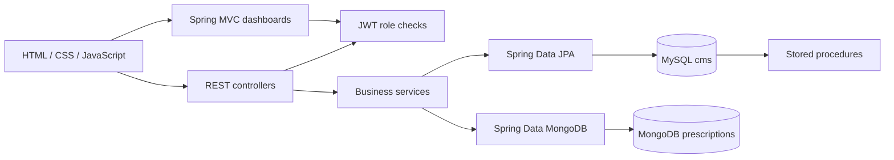

# Architecture design

SmartCare supports patient appointment management, doctor calendars/prescriptions, and administrator directory/reporting functions. All demonstration records are fictional.

## Seven-step request flow

1. The user operates an HTML/CSS/JavaScript interface, chooses a role and signs in. Public directory requests need no authentication.
2. Spring MVC serves the public page and Thymeleaf role dashboards. Dashboard routes validate the HttpOnly JWT cookie against the required role.
3. JavaScript submits REST requests. Thin controllers validate JSON bodies and Bearer tokens.
4. Services enforce identity, role, ownership, password comparison and one-hour appointment rules.
5. Spring Data JPA repositories persist administrators, doctors, patients and appointments in MySQL. Booking locks the doctor row and enforces a unique doctor/time pair.
6. Spring Data MongoDB stores flexible prescription documents linked to MySQL appointment IDs. Services check the appointment owner before reading or writing. MySQL stored procedures generate reports.
7. Controllers return structured JSON/status codes, or render MVC dashboards. The client updates directory cards, calendars, bookings and record dialogs.

## Deployment

The multi-stage Dockerfile builds/tests with Maven and Java 17 and runs the jar as a non-root user on a JRE. Compose waits for database health checks and exposes only the application loopback port. GitHub Actions verifies Maven and builds the image for pushes/PRs. Database/signing secrets enter through environment variables; `.env` stays ignored.

## Boundaries

MySQL is authoritative for appointment ownership and slot allocation. MongoDB has no cross-database transaction: prescription access first reads ownership in MySQL. Production handling of simultaneous appointment deletion would need explicit coordination. Keep authentication and persistence rules in services, never solely in browser code. This is one modular application, not a microservice deployment.
